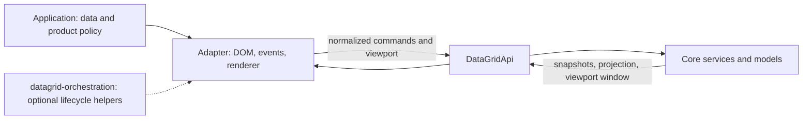

# Core and UI adapter boundaries

This page answers one question: which parts of a grid are provided by `@affino/datagrid-core`, and which parts a UI adapter must implement. It complements the [first example](./examples/local-data/README.md), [API overview](./grid-api.md), and [method reference](reference/api/grid-api-methods.md); it does not replace them.

## What Core provides

Core owns framework-independent state and rules: row and column models, the logical row projection, selection, view state, operations, and events. Its API uses stable `rowId` and `columnKey` identities; state does not depend on whether a corresponding DOM cell is currently mounted.

Core also provides algorithmic parts of virtualization: logical viewport/window calculations and model or geometry contracts. An adapter can use these to request the relevant range and materialize only that range. Exact support depends on the row model and entrypoint; see the [virtualization support matrix](../../../docs/reference/datagrid-virtualization-support-matrix.md).

## What the adapter provides

An adapter connects the engine to a platform and renderer:

- measures the container and receives actual scroll, pointer, and keyboard events;
- sends normalized commands and current viewport dimensions/position to Core;
- materializes DOM or framework components for the required window;
- maps recycled visual nodes back to logical IDs;
- manages focus, pointer capture, editors, overlays, accessibility markup, and cleanup.

On a browser platform, the adapter owns the DOM, CSS, layout measurement, and browser event subscriptions. Core can calculate a virtual window, but it cannot measure the DOM or render that window.

| Responsibility | Owner |
| --- | --- |
| Row/column identity, projection, and grid state | Core |
| Selection rules and selected IDs | Core |
| Logical viewport and virtual-window calculation when supported | Core |
| DOM measurement, scroll input, and visible-node rendering | UI adapter |
| Gesture ownership, pointer capture, hit testing, and browser focus | UI adapter; optionally orchestration |
| Business constraints, operation availability, and response to results | Application |

## When to use orchestration

`@affino/datagrid-orchestration` is an optional set of framework-independent interaction lifecycle helpers. It is useful to adapter authors coordinating gesture start, preview, commit/cancel, or mutual exclusion between competing interactions.

Orchestration does not own data, projection, selection snapshots, or the DOM. An application using the ready-made `DataGrid` does not need it. It is also unnecessary for a simple handler that calls `DataGridApi`; add it when the adapter needs a shared transition lifecycle.

Its current surface belongs to the advanced adapter-internal tier and can change faster than the stable Core API. Check the [orchestration compatibility contract](../../../docs/internal/reference/datagrid-orchestration-public-contract.md) before depending on it. Core works without this package.

## Virtualization flow in an adapter

1. The adapter measures the viewport and sends current state through the supported API.
2. Core resolves the logical projection and calculates the row/column window supported by the configured models.
3. The adapter reads the snapshot/window and mounts the required visual nodes.
4. DOM nodes are associated with `rowId`/`columnKey`; indices of mounted elements are never treated as persistent identity.
5. On scroll, the adapter synchronizes the viewport. A change to the rendered window does not change logical selection.

Not every Core configuration provides the same virtualization capabilities. Before building an adapter, check the row model, viewport API, and expected behavior in the [support matrix](../../../docs/reference/datagrid-virtualization-support-matrix.md). Use the public contract of the selected entrypoint rather than copying Vue internals.

## Continue with

- Assemble and run the engine: [local data example](./examples/local-data/README.md).
- Find the right namespace: [API overview](./grid-api.md).
- Choose constructors: [factory reference](reference/api/factories.md).
- Check method signatures, results, and capability requirements: [method reference](reference/api/grid-api-methods.md).
