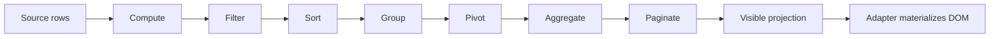

# Core module guides

These guides explain the engine behavior behind the public API. They focus on state ownership, pipeline participation, invariants, and adapter boundaries. For exact signatures use the [API reference](../api/README.md).

## Data projection

| Module | Responsibility | Guide |
| --- | --- | --- |
| Row model | Owns source row identity, model capabilities, snapshots, and projected reads. | [Row model](./row-model.md) |
| Columns | Owns column definitions, stable keys, display order, visibility, sizing, and pin state. | [Columns](./columns.md) |
| Projection pipeline | Orders transformations, tracks dependencies, and recomputes only stale stages. | [Projection pipeline](./projection-pipeline.md) |
| Filtering | Produces the set of source rows that match filter state. | [Filtering](./filtering.md) |
| Sorting | Orders matching rows using the active sort model. | [Sorting](./sorting.md) |
| Grouping | Builds hierarchical group rows from ordered matching rows. | [Grouping](./grouping.md) |
| Aggregation | Computes aggregate values for configured columns and groups. | [Aggregation](./aggregation.md) |
| Pivot | Produces analytical rows and columns through the pivot package integration. | [Pivot](./pivot.md) |
| Pagination | Selects a page from the aggregated projection. | [Pagination](./pagination.md) |

## Runtime capabilities

| Module | Responsibility | Guide |
| --- | --- | --- |
| Selection | Keeps cell ranges, record IDs, and whole-column selection as separate states. | [Selection](./selection/README.md) |
| Viewport and virtualization | Provides canonical viewport state and geometry contracts consumed by adapters. | [Viewport](./viewport.md) |
| Transactions | Applies reversible operations and maintains undo/redo history. | [Transactions](./transactions.md) |
| Computed fields | Computes derived values and coordinates formula dependencies. | [Computed fields](./computed-fields.md) |
| Datasource | Bridges demand-driven row ranges to pull/push/invalidation sources. | [Datasource](./data-source.md) |
| Editing | Applies user-originated edits through the row model and datasource boundary. | [Editing](./editing.md) |
| State and events | Captures/restores versioned state and publishes typed API changes. | [State and events](./state-and-events.md) |

The client projection stage order and dependencies are defined in Core's stage registry. A server-backed row model may delegate some or all transformations to its datasource; the client stage diagram does not imply that every row model executes every stage locally.
