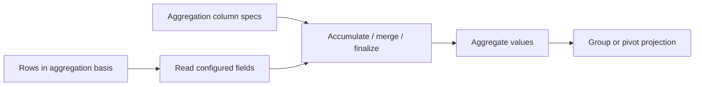

# Aggregation

The aggregation model defines how configured columns summarize row values. It is separate from grouping: grouping defines hierarchy, while aggregation defines values derived for that hierarchy. Aggregation can also be configured with a source or filtered basis.

Configure the model through `api.rows.setAggregationModel(model)` and read it with `getAggregationModel()`. Passing `null` disables it. A column specification names its output `key`, input `field`, aggregation operation or custom aggregation handlers, and optional coercion behavior.

Aggregation is part of the client projection dependency graph and follows pivot in the current client pipeline. This does not promise that every row model supports local aggregation; check the row model's capabilities and use the datasource contract when aggregation is delegated remotely.

See [row API methods](../api/methods/rows.md#projection-and-grouping) and the [projection pipeline](./projection-pipeline.md) for configuration and stage order.
