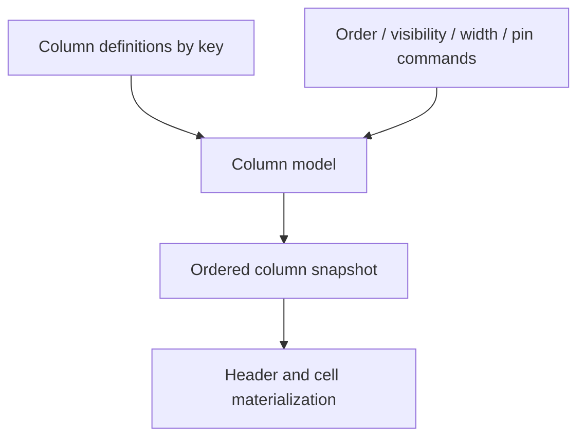

# Column model

The column model owns column definitions and their current layout state. A stable `columnKey` identifies a column; display indexes and positions within pinned/center zones are coordinates that can change after layout operations.

The model supports replacing or inserting definitions, changing global or per-zone order, toggling visibility, setting widths, and assigning pin state. Those calls update model state and emit `columns:changed`; they do not perform drag-and-drop, measure DOM, or move a scroll element.

Pin values (`left`, `right`, `none`) describe where a column is pinned. Column zones (`pinnedLeft`, `center`, `pinnedRight`) describe positions in the ordered layout. Selection state uses stable keys and is independent from visibility and order.

See [column methods](../api/methods/columns.md), [column selection](./selection/column-selection.md), and the [API method signatures](../api/grid-api-methods.md#columns).
