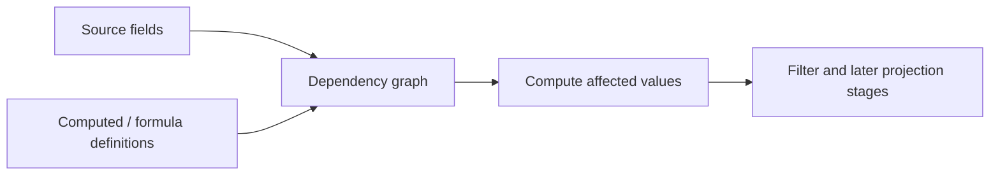

# Computed fields and formulas

Computed fields extend row values with model-owned derived values. Formula fields use the formula engine contract and dependency graph; Core coordinates registration, invalidation, and recomputation for the row model.

Register definitions through `api.rows.registerComputedField()` or `registerFormulaField()`. Read registered descriptors with the corresponding getter. Recompute all rows or a specified set with `recomputeComputedFields()`; use `recomputeFormulaContext()` when external context keys change. Unregistering a field that still has dependents is rejected.

Registration is validated against duplicate names, duplicate target fields, unknown computed dependencies, and dependency cycles according to the configured cycle policy. Initial definition sets are planned together so references between fields in the same set can be ordered. Runtime registration is one field per call; a failed registration does not publish the new definition. Re-registering an existing computed/formula name throws. A formula function name can be replaced with `registerFormulaFunction()`; registered formulas are recompiled, and the previous registry is restored if recompilation fails. Removing a function still referenced by a formula fails and restores the function. Remove dependent fields before their inputs or functions.

Formula evaluation errors are cell/runtime results and do not mean the schema registration itself failed. Formula registrations and compute work are owned by the row model; a remote datasource does not imply remote calculation. When computing asynchronously, use the model's existing compute-mode and diagnostics contracts to identify pending or failed work rather than assuming a field registration means every visible row has already materialized a value.

Computed/formula stage results feed client filtering and later projection stages. Server-backed datasource behavior does not imply remote formula evaluation: the in-process datasource contract currently treats formula evaluation as client/model-owned unless the host provides an external layer.

This guide covers Core's row-model integration. Formula syntax, execution kernels, and engine-specific options belong to the [formula engine package documentation](../../../../datagrid-formula-engine/README.md).
