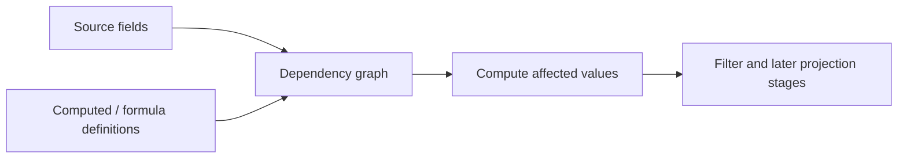

# Computed fields and formulas

Computed fields extend row values with model-owned derived values. Formula fields use the formula engine contract and dependency graph; Core coordinates registration, invalidation, and recomputation for the row model.

Register definitions through `api.rows.registerComputedField()` or `registerFormulaField()`. Read registered descriptors with the corresponding getter. Recompute all rows or a specified set with `recomputeComputedFields()`; use `recomputeFormulaContext()` when external context keys change. Unregistering a field that still has dependents is rejected.

Computed/formula stage results feed client filtering and later projection stages. Server-backed datasource behavior does not imply remote formula evaluation: the in-process datasource contract currently treats formula evaluation as client/model-owned unless the host provides an external layer.

This guide covers Core's row-model integration. Formula syntax, execution kernels, and engine-specific options belong to the [formula engine package documentation](../../../../datagrid-formula-engine/README.md).
