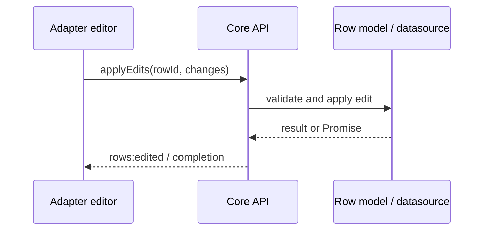

# Editing

Editing changes row data through the row model. Core provides edit operations and cell parsing/validation helpers; an adapter/orchestration layer owns the edit-session draft, editor controls, focus, and commit/cancel gestures. Core does not keep a draft or an active editor session.

Use `api.rows.applyEdits()` for user-originated changes. Client models may complete synchronously; datasource-backed models can return a Promise. Await promise results and handle rejection or abort. Use `applyExternalUpdates()` for changes originating from an external cache/source; it has a distinct policy and event source.

Resolve a logical cell's current accessor value with `api.cells.resolveValue({ rowId, columnKey, purpose: "computed" })`. Keep the initial source value when opening an editor. Before committing, compare it with the current resolved value; the Vue app adapter rejects the edit and keeps the editor open when the cell changed during the draft. Other adapters must choose and document their own conflict policy. A value getter/accessor is read-only unless the column also supplies a `valueSetter` or the resolver reports a row-patch target. A display-formatted string is for presentation and must not be sent to `applyEdits()` as if it were the typed value.

An edit may request projection reapplication according to its options and model policy. It is not automatically an undo-history entry. When the edit must participate in undo/redo, use the transaction service and ensure the selected transaction operation represents the intended mutation.

The editor widget, validation presentation, and focus handoff belong to the adapter/application. See [cell value methods](../api/methods/cells.md), [row methods](../api/methods/rows.md#patches-edits-and-external-updates), [transactions](./transactions.md), and [datasource](./data-source.md).
