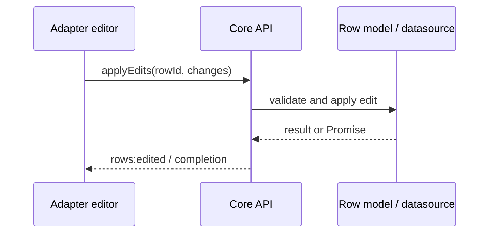

# Editing

Editing changes row data through the row model. Core provides edit operations and edit-model contracts; a UI adapter owns editor controls, parsing user input, focus, and commit/cancel gestures.

Use `api.rows.applyEdits()` for user-originated changes. Client models may complete synchronously; datasource-backed models can return a Promise. Await promise results and handle rejection or abort. Use `applyExternalUpdates()` for changes originating from an external cache/source; it has a distinct policy and event source.

An edit may request projection reapplication according to its options and model policy. It is not automatically an undo-history entry. When the edit must participate in undo/redo, use the transaction service and ensure the selected transaction operation represents the intended mutation.

The editor widget and validation presentation belong to the adapter/application. See [row methods](../api/methods/rows.md#patches-edits-and-external-updates), [transactions](./transactions.md), and [datasource](./data-source.md).
