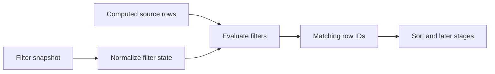

# Filtering

Filtering is a projection operation: it determines which source rows continue into sorting and later stages. It does not delete rows or mutate source data. The Core API stores the filter snapshot and the client row model evaluates it during projection recomputation.

## Filter state

`DataGridFilterSnapshot` can contain:

- `columnFilters`: per-column value-set or predicate filters;
- `columnStyleFilters`: style-value sets resolved through the model's style reader;
- `advancedExpression`: a nested `and` / `or` / `not` expression over typed conditions;
- `quickFilter`: text search over configured columns, or the model's default searchable columns.

Use `api.rows.setFilterModel(snapshot)` to replace the active filter model, or pass `null` to clear it. `api.rows.setSortAndFilterModel()` is available when sort and filter are one logical update. Check `api.capabilities.sortFilterBatch` if one combined recomputation is required.

## Ownership and limits

- The Core row model evaluates client filters against rows available to that model.
- The adapter owns filter controls and translates user input into a filter snapshot.
- A datasource-backed model passes filter state to its datasource; the datasource owns remote query execution and must include the effective filter state in request/cache identity.
- Filtered-out rows remain in the source model. A filtered row is not the same as a deleted row.
- A change to filter state can change projected indexes. Persist row identity by `rowId`, not a current projection index.

See [`DataGridFilterSnapshot`](../../../../datagrid-pivot/src/coreTypes.ts) for the shared filter contract and the [API method behavior](../api/methods/rows.md#projection-and-grouping) for method semantics.
