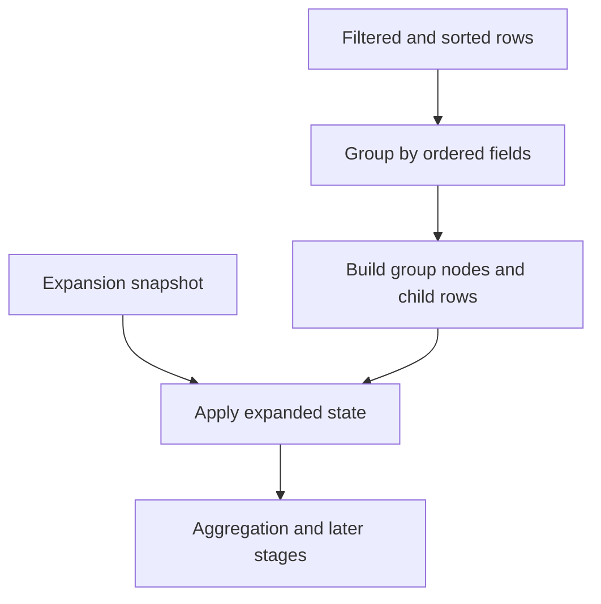

# Grouping

Grouping transforms ordered matching rows into a hierarchical projection. Group rows are synthetic projection nodes; their IDs and keys are for projection identity and are not source record IDs.

`api.rows.setGroupBy({ fields, expandedByDefault })` replaces the grouping definition; `null` disables grouping. The order of `fields` defines nesting order. Expansion is separate state: use `setGroupExpansion`, `expandGroup`, `collapseGroup`, or `toggleGroup` to change which descendants appear.

Grouping does not imply that a group header is a selectable source record. Consumers should inspect row-node kind and use stable source row IDs for record-level operations. The adapter renders group rows and routes expansion controls; Core produces the logical group projection.

See [`DataGridGroupBySpec`](../../../../datagrid-pivot/src/coreTypes.ts), [row API methods](../api/methods/rows.md#projection-and-grouping), and the [projection pipeline](./projection-pipeline.md).
