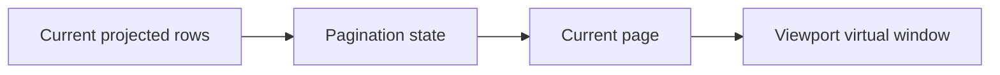

# Pagination

Pagination selects a page from the current projected rows. It is a row-model operation and is independent of the adapter's viewport virtualization: pagination chooses the logical dataset slice, while virtualization chooses which part of the current view is materialized.

Use `api.rows.setPagination({ pageSize, currentPage })` to enable or update pagination; pass `null` to disable it. `setPageSize()` and `setCurrentPage()` update individual values. Read normalized state with `getPagination()`; it includes page count, total row count, and page bounds.

Changing filters or other upstream projection state may change page count and valid page bounds. Let the row model normalize the requested page, then read a fresh snapshot. Server-backed models may delegate page slicing to the datasource; requests carry pagination context as part of effective runtime state.

See [row API methods](../api/methods/rows.md#projection-and-grouping), the [projection pipeline](./projection-pipeline.md), and the [datasource API](./data-source.md).
