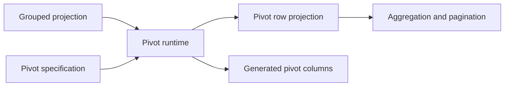

# Pivot

Pivoting reshapes grouped row data into analytical row and generated-column projections. Core integrates the row model with `@affino/datagrid-pivot`, which owns the pivot contracts and runtime. The adapter remains responsible for rendering generated headers and cells.

Use `api.pivot.setModel(spec)` to enable or replace the pivot configuration; pass `null` to disable it. `getModel()` reads the current model. `getCellDrilldown()` resolves source rows for a pivot cell when the row model supports that operation; it does not navigate or load missing rows.

Pivot layouts include related projection and column state for reuse. `exportLayout()` captures layout state; `importLayout()` applies it and is not a general atomic state restore. `exportInterop()` additionally includes generated columns and currently projected row nodes for data transfer. Use versioned `api.state` when restoring broader grid state.

The current client projection places pivot after grouping and before aggregation/pagination. Server-backed pivot is a separate datasource capability and should not be inferred from the client stage pipeline.

See [pivot methods](../api/methods/pivot.md), the [pivot package](../../../../datagrid-pivot/README.md), and the [projection pipeline](./projection-pipeline.md).
