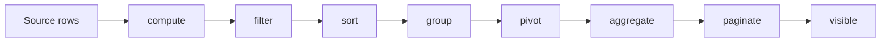

# Client projection pipeline

The client row model transforms source rows into the logical row projection read by `api.rows`. The stages are dependency-tracked: when one input changes, Core recomputes that stage and the stages that depend on it. The adapter renders a window from the resulting projection; it does not own these transformations.

| Stage | Input or owner | Output role |
| --- | --- | --- |
| `compute` | Source rows and registered computed/formula fields | Updated source values and dependency results. |
| `filter` | Filter snapshot and computed source values | Matching source row IDs. |
| `sort` | Matching rows and sort model | Ordered matching rows. |
| `group` | Ordered rows, group-by fields, expansion state | Hierarchical group and leaf nodes. |
| `pivot` | Grouped rows and pivot model | Pivoted row projection and generated pivot columns. |
| `aggregate` | Current grouped/pivoted structure and aggregation model | Aggregate values for the configured basis. |
| `paginate` | Aggregated projection and page state | Current page slice and pagination metadata. |
| `visible` | Current page and expansion state | Final visible row sequence. |

`setSortAndFilterModel()` can use the optional `sortFilterBatch` capability to apply both models in one projection update. Without that capability, the API applies filter and sort sequentially. Other updates invalidate their dependent stages according to the stage graph.

This is the client row model pipeline. Server-backed models receive canonical state in datasource requests and may perform filtering, sorting, grouping, pivoting, and pagination remotely. See [datasource](./data-source.md) for that boundary.

## Source map

- Stage dependency graph: `packages/datagrid-core/src/models/projection/clientRowProjectionStageRegistry.ts`
- Invalidation roots and refresh planning: `packages/datagrid-core/src/models/projection/projectionStages.ts`
- Stage implementations: `packages/datagrid-core/src/models/projection/`
- Public configuration: `api.rows` in the [method reference](../api/methods/rows.md)
