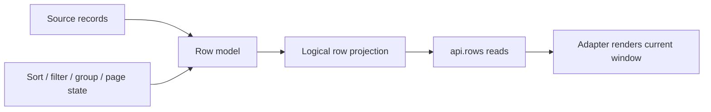

# Row model

The row model is the Core boundary for source records and their current logical projection. It owns stable row identity, model capabilities, projection snapshots, and row reads. An adapter renders the projected window; it should not become a second owner of row data or projection order.

Core can be assembled with different row model implementations. A client model owns in-process source data and can execute projection stages locally. Server-backed models may expose a sparse loaded cache and delegate demand or query work through a datasource. The common `DataGridRowModel` contract does not mean every implementation supports every mutation or projection feature.

## Identity and indexes

- Use a stable `rowId` for a source record across sorting, filtering, and viewport movement.
- `api.rows.get(index)` addresses the current projection. Its meaning can change when projection state changes.
- `api.rows.getById(rowId)` is a local availability lookup when the model supports it; it does not load, reveal, or expand the record.
- `getRowById(rowId)` on the row-model contract returns the source row. It does not promise computed overlay fields.
- `getEffectiveRowById(rowId)` is an optional model capability for returning the current materialized row with computed overlays. A model that does not support effective lookup omits it; consumers must handle that result explicitly.
- Projection nodes can be synthetic group or pivot rows. Check node kind before treating a projected node as a source record.

Use `api.rows.has*Support()` or `api.capabilities` before exposing optional model operations. The [row methods reference](../api/methods/rows.md) describes each operation; [factories](../api/factories.md) documents supported construction paths.
