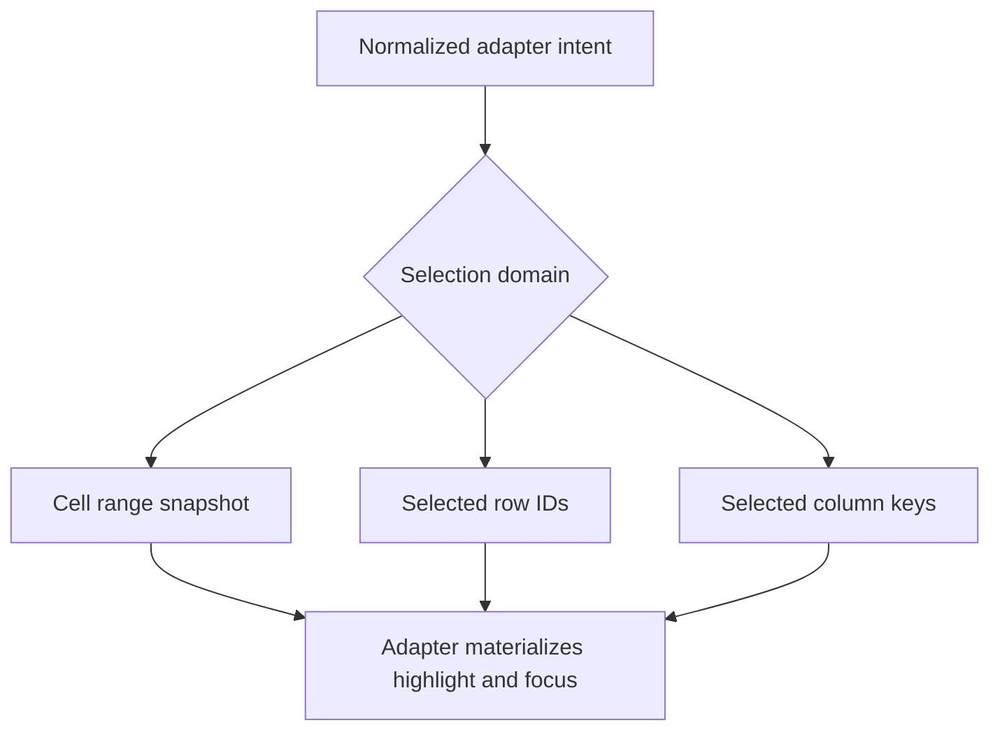

# Selection modules

Core keeps three selection states separate because they answer different questions. Cell ranges describe selected coordinates, row selection describes selected records, and column selection describes selected columns. The adapter owns gestures, focus, and visual presentation.

| State | Identity | Detailed contract |
| --- | --- | --- |
| Cell/range selection | Current logical row and column coordinates, with endpoint identities where known | [Cell and range selection](./cell-range.md) |
| Record selection | Stable `rowId` values | [Row selection](./row-selection.md) |
| Whole-column selection | Stable `columnKey` values | [Column selection](./column-selection.md) |

The `DataGridApi` facade exposes corresponding `selection`, `rowSelection`, and `columnSelection` namespaces. Their snapshots are independent. One gesture must be assigned to one selection owner by the adapter before it changes state. Selection does not imply keyboard focus, and Core does not render selection styles.

For method signatures see [selection methods](../../api/methods/selection.md); for the application row-header interaction policy see the [cross-package architecture contract](../../../../../../docs/datagrid-architecture.md#selection-ownership).
