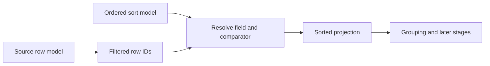

# Sorting

Sorting orders rows that survive filtering. It changes projection order, not source order or row identity.

Each `DataGridSortState` identifies a `key`, optionally supplies a `field` and `dependencyFields`, chooses `asc` or `desc`, and may define comparator policy. Comparator policies include default, locale-aware, natural, and registered custom comparator behavior. Stable row IDs remain the identity even when positions change.

Use `api.rows.setSortModel(model)` to replace sort state. When the user changes sort and filter together, use `setSortAndFilterModel()`; its one-pass behavior depends on `sortFilterBatch` support. The adapter owns sort indicators and input gestures. The row model owns client ordering; datasource-backed models may delegate ordering to the datasource using the canonical `sortModel` request field.

Do not store a displayed index as a durable row reference. Re-resolve a `rowId` against the current projection after sorting.

See [`DataGridSortState`](../../../../datagrid-pivot/src/coreTypes.ts), [row API methods](../api/methods/rows.md#projection-and-grouping), and the [projection pipeline](./projection-pipeline.md).
