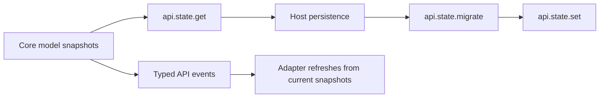

# State and events

Core exposes a versioned unified state snapshot and typed API events. State snapshots support import/export across model boundaries; events notify consumers that a subsystem changed. Neither is a UI rendering lifecycle.

`api.state.get()` captures supported model state. `migrate()` normalizes versioned input; `set()` validates and applies state through the bound model APIs. State application is a sequence of subsystem transitions unless an explicitly requested atomic mode can roll back supported local state. A raw engine snapshot should not automatically be treated as an end-user saved view.

Subscribe through `api.events.on()` and retain the unsubscribe callback for teardown. Event payloads report what changed; read a current subsystem snapshot when the consumer needs authoritative state. Core events are synchronous at the API boundary, and API reentrant delivery is queued in order. An event does not mean a framework render has finished.

See [state, events, and plugin methods](../api/methods/state-events.md), the [event matrix](../../../../../docs/reference/datagrid-event-matrix.md), and the [state event contract](../../../../../docs/datagrid-state-events-compute-diagnostics.md).
