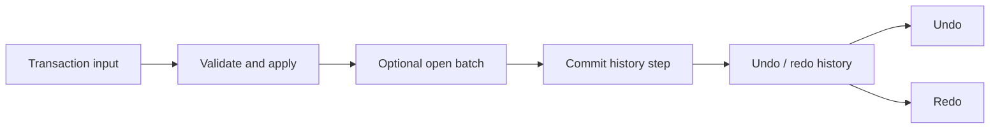

# Transactions and history

The transaction service applies reversible operations and tracks committed history for undo/redo. Direct row model mutations such as `api.rows.setData()` or `api.rows.patch()` do not automatically create history entries.

Use `api.transaction.apply()` for a reversible operation. `beginBatch()` starts the one pending batch; batches cannot nest. `commitBatch()` creates one history unit asynchronously, while `rollbackBatch()` rolls back pending work. `undo()` and `redo()` operate on committed steps.

`api.rows.batchMutations()` serves a different purpose: it coalesces supported synchronous row-model recomputation and does not provide undo/redo. Choose transaction batches when history semantics matter and row mutation batching when only projection recomputation needs coalescing.

See [transaction method behavior](../api/methods/transactions.md) and the [transaction API signatures](../api/grid-api-methods.md#transaction).
