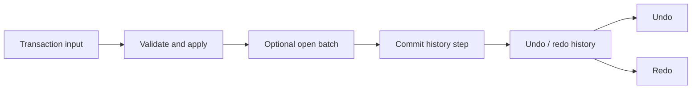

# Transactions and history

The transaction service applies reversible operations and tracks committed history for undo/redo. Direct row model mutations such as `api.rows.setData()` or `api.rows.patch()` do not automatically create history entries.

Use `api.transaction.apply()` for a reversible operation. `beginBatch()` starts the one pending batch; batches cannot nest. While a batch is open, `apply()` resolves when its transaction is queued, before any command runs. `commitBatch()` then applies queued transactions sequentially and records the non-empty batch as one history step. `rollbackBatch()` discards queued transactions; it does not execute their rollback commands because they have not been applied. A failed commit rejects, clears the pending batch, and attempts compensation for work already applied by that commit. Catch `DataGridTransactionBatchCommitError` to inspect the immutable `report`; compensation failures are listed individually, and every prior transaction receives a compensation attempt even when another attempt fails.

`api.rows.batchMutations()` serves a different purpose: it coalesces supported synchronous row-model recomputation and does not provide undo/redo. Choose transaction batches when history semantics matter and row mutation batching when only projection recomputation needs coalescing.

See [transaction method behavior](../api/methods/transactions.md) for completion points, cancellation limits, and failure behavior, and the [transaction API signatures](../api/grid-api-methods.md#transaction).
