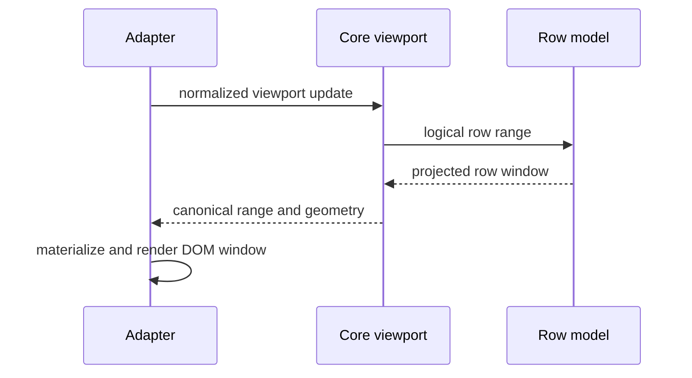

# Viewport and virtualization

Core owns canonical viewport state and geometry contracts. An adapter samples its scroll element and DOM sizes, materializes the virtual window, and renders rows/cells. This division lets different UI frameworks use the same logical range and geometry rules without Core depending on a DOM.

`api.view.setViewportRange()` communicates the current logical row range to the row model. Semantic position methods can request or restore a row, column, or cell target. They do not return DOM nodes. `activateCell()` is the higher-level operation for adapters that implement reveal, selection, and focus policy around a logical cell.

The adapter owns actual scroll elements, DOM measurement, requestAnimationFrame scheduling, pinned pane synchronization, sticky occlusion, and rendered-node lifecycle. It must not create a second authoritative virtualization model or infer durable identity from recycled DOM indices.

For cross-package support and limitations, see the [virtualization support matrix](../../../../../docs/reference/datagrid-virtualization-support-matrix.md), the [viewport controller decomposition](../../../../../docs/internal/architecture/datagrid-viewport-controller-decomposition.md), and the [viewport math engine](../../../../../docs/internal/architecture/datagrid-viewport-math-engine.md).
